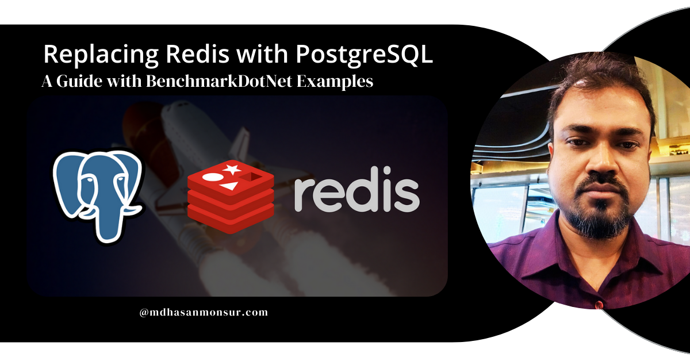
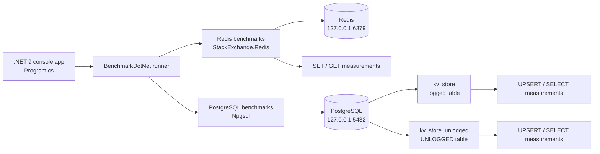
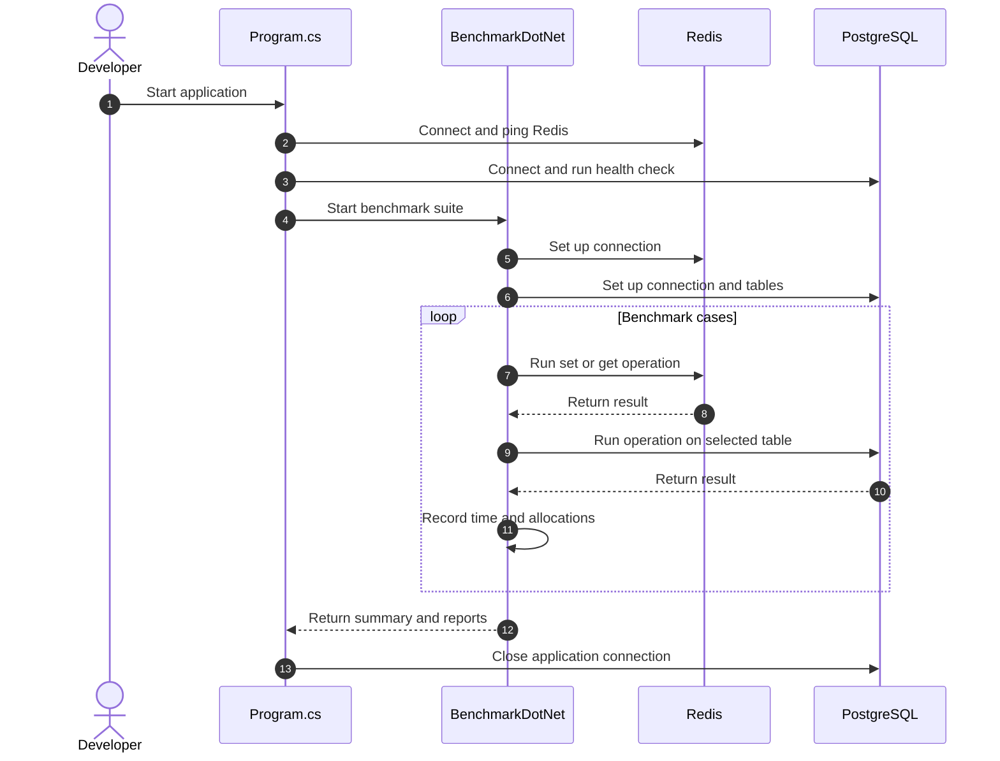

# Replacing Redis with PostgreSQL: .NET 9 Benchmark

A small **C#/.NET 9 BenchmarkDotNet** project comparing basic Redis and PostgreSQL key-value `SET` and `GET` operations. It also measures PostgreSQL using a regular table and an `UNLOGGED` table, helping developers explore when PostgreSQL might handle a simple key-value workload without operating a separate Redis service.

> This is a focused local benchmark—not a general claim that PostgreSQL is faster than Redis or a drop-in replacement for every Redis feature. See the [benchmark results](#benchmark-results-and-interpretation) and [limitations](#limitations) before drawing conclusions.



## Table of contents

- [What this project compares](#what-this-project-compares)
- [Architecture and data flow](#architecture-and-data-flow)
- [Sequential benchmark flow](#sequential-benchmark-flow)
- [Prerequisites and running](#prerequisites-and-running)
- [Benchmark results and interpretation](#benchmark-results-and-interpretation)
- [Potential benefits](#potential-benefits)
- [Use cases](#use-cases)
- [Limitations](#limitations)

## What this project compares

The benchmark in `RedisVsPostgresBenchmarks.cs` performs synchronous operations using the same sample key and value:

| Backend | Write operation | Read operation |
| --- | --- | --- |
| Redis | `StringSet` | `StringGet` |
| PostgreSQL (regular table) | `INSERT ... ON CONFLICT ... DO UPDATE` | `SELECT ... WHERE key = @key` |
| PostgreSQL (`UNLOGGED` table) | Same upsert against `kv_store_unlogged` | Same lookup against `kv_store_unlogged` |

BenchmarkDotNet's `MemoryDiagnoser` reports elapsed time and managed allocations. Database connections and PostgreSQL test tables are prepared in the benchmark setup, outside the measured operation methods.

## Architecture and data flow

The console application checks local Redis and PostgreSQL connectivity, then BenchmarkDotNet invokes each benchmark against the selected backend. Each operation uses the same fixed sample key/value, while PostgreSQL stores the pair in a table whose `key` column is the primary key.



## Sequential benchmark flow



## Prerequisites and running

- .NET 9 SDK
- Redis reachable at `localhost:6379`
- PostgreSQL reachable at `localhost:5432`, with database `postgres` and credentials `postgres` / `postgres` (as configured in `Program.cs` and `RedisVsPostgresBenchmarks.cs`)

Start local services if needed (the PostgreSQL command below is for a disposable local benchmark instance; change the password for any non-local deployment):

```bash
docker run --rm --name redis-benchmark -p 6379:6379 -d redis:7
docker run --rm --name postgres-benchmark \
  -e POSTGRES_PASSWORD=postgres \
  -p 5432:5432 -d postgres:17
```

Then run the benchmark from the repository root:

```bash
dotnet restore
dotnet run --configuration Release
```

BenchmarkDotNet writes generated reports under `BenchmarkDotNet.Artifacts/results/`. The repository includes a sample report at [`BenchmarkDotNet.Artifacts/results/RedisVsPostgresBenchmark.RedisVsPostgresBenchmarks-report-github.md`](BenchmarkDotNet.Artifacts/results/RedisVsPostgresBenchmark.RedisVsPostgresBenchmarks-report-github.md).

## Benchmark results and interpretation

The checked-in BenchmarkDotNet report was produced on Windows 11 with an Intel Core i7-8750H, .NET 9.0.1, and BenchmarkDotNet 0.14.0. The table below reproduces the reported means and allocations:

| Operation | Mean | Allocated |
| --- | ---: | ---: |
| Redis set | 463.5 μs | 193 B |
| Redis get | 413.0 μs | 201 B |
| PostgreSQL set (regular table) | 2,629.9 μs | 1,280 B |
| PostgreSQL get (regular table) | 436.5 μs | 1,011 B |
| PostgreSQL set (`UNLOGGED` table) | 450.6 μs | 1,290 B |
| PostgreSQL get (`UNLOGGED` table) | 448.9 μs | 1,033 B |

These are results from one machine and a simple localhost workload. Treat them as an example to reproduce and investigate—not a universal performance ranking. In particular, the regular PostgreSQL table's measured write is much slower in this sample, while the `UNLOGGED` table's measured write is similar to Redis. Validate with representative data, workload, configuration, and durability requirements before making an architectural decision.

## Potential benefits

For workloads that fit PostgreSQL's capabilities, consolidating a simple key-value store into an existing PostgreSQL deployment may:

- Reduce the number of separate services to deploy, monitor, secure, and back up.
- Keep relational records and simple key-value data within one operational system.
- Make it possible to use SQL, transactions, PostgreSQL access controls, and existing backup practices for that data.
- Avoid introducing a separate Redis dependency for a small, straightforward workload.

These are possible operational benefits, not guaranteed outcomes. Measure the impact on the existing database and account for its availability, capacity, and operational requirements.

## Use cases

Consider evaluating PostgreSQL for **simple, modest-volume key-value data** when the application already depends on PostgreSQL and consolidation is valuable, for example:

- Application settings or small configuration records.
- Low-volume shared state where SQL access and relational integration are useful.
- Prototypes or internal tools where operating another service would add unnecessary complexity.
- Workloads where the team wants to compare regular and `UNLOGGED` PostgreSQL table behavior under its own conditions.

The sample does not implement Redis TTL, expiration, eviction, pub/sub, or other Redis features. Those requirements need separate design and validation; they should not be assumed to work as shown here.

## Limitations

- Only basic single-key set/get operations are benchmarked, with one constant key and value.
- Operations are synchronous and use local database services; network, concurrency, throughput, varied payload sizes, and production-scale load are not represented.
- `UNLOGGED` PostgreSQL tables are not crash-safe: PostgreSQL truncates them after a crash or unclean shutdown, and they are not replicated to standby servers. Use them only when that data loss is acceptable; they are not equivalent to Redis in every respect.
- The sample connection strings are hard-coded for local development. Do not use these credentials or expose these services in production.
- Benchmark outputs depend on the machine, database configuration, runtime, and workload. Re-run the benchmark in a controlled environment before making a decision.

## Search keywords

Redis vs PostgreSQL benchmark, replacing Redis with PostgreSQL, PostgreSQL key-value store, Redis alternative, .NET 9 BenchmarkDotNet, Npgsql, StackExchange.Redis, PostgreSQL `UNLOGGED` table performance.
